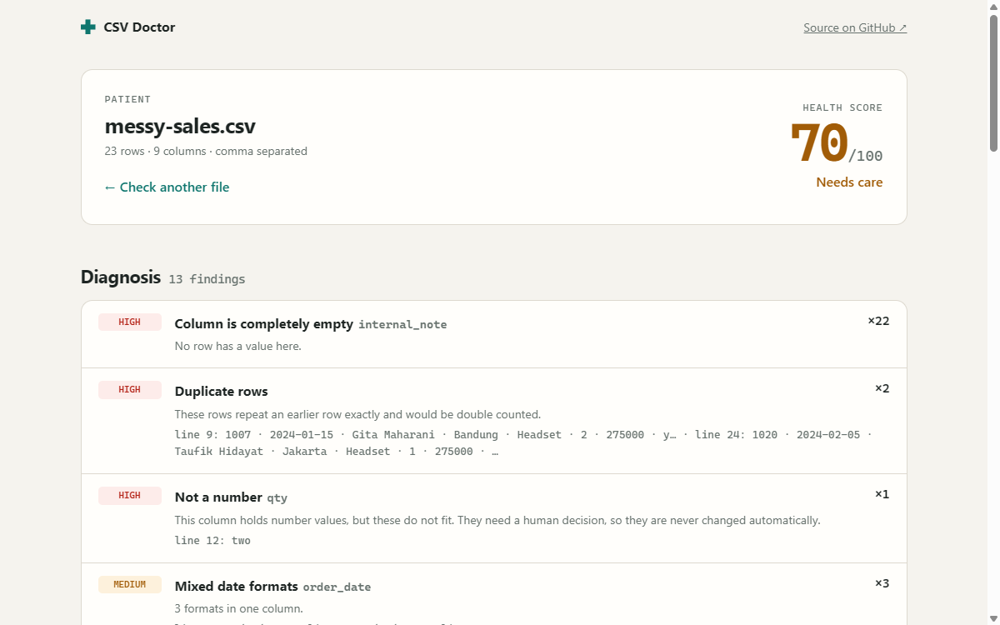

# CSV Doctor

An instant data-quality report and one-click cleaning for CSV files. Everything runs in your browser, so your data is never uploaded.

**[Try it live](https://adhigozalt.github.io/csv-doctor/)**, no file needed: there is a messy sample to play with.



## What it checks

| Finding | How it is detected | Fixed automatically? |
|---|---|---|
| Missing values | Blanks plus stand-ins such as `N/A`, `null` and `-` | Stand-ins are blanked |
| Duplicate and empty rows | Rows compared after trimming | Yes |
| Wrong data types | A column's type is the one held by at least 80% of its values | No, flagged for review |
| Extreme values | Tukey fence at 3 × IQR, with at least 8 values | No, flagged for review |
| Mixed date formats | ISO, numeric and written dates, in English or Indonesian | Yes, when day and month order is provable |
| Formatted numbers | `1,234.50`, `1.234,50`, `Rp 1.500.000`, `$20` | Yes |
| Inconsistent capitalisation | `Jakarta`, `jakarta`, `JAKARTA` | Yes, to the most common spelling |
| Extra spaces | Leading, trailing and doubled spaces | Yes |
| Broken structure | Short or long rows, blank or repeated headers, unclosed quotes | Repaired on read and reported |

The **health score** is the share of cells with no finding. A cell with several problems counts once.

## Design decisions

- **It never guesses with your data.** `03/01/2024` could be January or March, so a date only changes if other values in the column prove the order. Outliers and wrong-type values are never altered.
- **Numbers stay as text internally.** Cleaning rewrites strings rather than converting through floating point, so long IDs keep every digit.
- **Codes are not numbers.** Values with leading zeros, such as phone numbers and postal codes, are treated as text.
- **No dependencies.** The parser is a small RFC 4180 state machine with delimiter detection for comma, semicolon, tab and pipe. It reports source line numbers even when values span several lines.

## Run it locally

Requires Node.js 22 or newer.

```sh
npm start   # serves the app at http://localhost:4173
npm test    # runs the test suite
```

## Project layout

```
src/parser.js   CSV reading, writing and delimiter detection
src/values.js   Understanding a single cell: numbers, dates, missing values
src/analyze.js  Column profiling, findings and the health score
src/clean.js    The safe, mechanical fixes
src/app.js      Browser interface
```

## License

MIT
